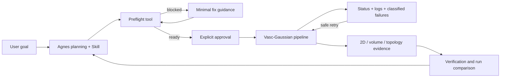

# VascPilot competition submission draft

## Project name

**VascPilot: an Agnes Harness agent for trustworthy sparse-view cerebrovascular reconstruction**

Chinese title: **VascPilot：基于 Agnes Harness 的可信稀疏视角脑血管重建智能体**

## Problem and value

Sparse-view X-ray reconstruction reduces acquisition views but creates an ill-posed reconstruction problem. A high 2D projection score alone does not prove that small vessels remain connected in 3D. VascPilot turns an existing Vasc-Gaussian research pipeline into a controllable agent workflow that checks inputs, executes reconstruction, captures feedback, verifies multi-level metrics, handles defined failures, and preserves reproducible evidence.

This is a research prototype for engineering/scientific validation, not a clinical diagnostic device.

## Closed execution loop

1. Agnes plans the experiment and selects a committed profile.
2. `vasc_preflight` checks data, configuration, Python modules, CUDA, disk, and Git revision.
3. `vasc_start_run` asks the user for approval before consuming GPU time or writing outputs.
4. The bridge executes training, novel-view rendering, 2D evaluation, DGR volume export, 3D evaluation, and topology evaluation.
5. Status and bounded logs return execution feedback to Agnes.
6. Failures are classified. DGR export may retry once with a smaller batch after CUDA OOM; scientific hyperparameters are never silently changed.
7. `vasc_verify_run` checks the evidence chain and finite metrics.
8. `vasc_compare_runs` reports candidate-minus-baseline changes for PSNR, SSIM, Dice, clDice, centerline recall, HD95, and component statistics.

## AGH contribution

AGH is not a decorative chat interface. It provides the model runtime, tool registry, package trust boundary, explicit approval gate, execution trace, Skill workflow, and feedback/verification loop. The scientific engine is exposed through seven restricted tools; no arbitrary model-generated shell command is accepted.

## Reproducibility evidence

Each run stores:

- Git commit and bridge version;
- selected profile, mode, Python, GPU and preflight report;
- resolved YAML configuration and SHA-256;
- exact argument arrays for every stage;
- append-only event ledger and full run log;
- generated renders, volume and evaluation files;
- verification checks and summarized metrics.

## Existing work and new competition work

Existing foundation: the public Vasc-Gaussian repository, itself derived from and extending X-Gaussian/3D Gaussian Splatting research code, plus previously developed vessel-aware losses, priors, export, and evaluation scripts.

Competition-period work: the AGH tool plugin, safe profile bridge, preflight and approval flow, background run control, provenance/evidence ledger, verification/comparison tools, failure classification/retry policy, workspace Skill, deployment guide, and competition demonstration workflow.

No claim is made that all upstream code was independently authored during the competition. See `THIRD_PARTY_NOTICES.md` and the repository history.

## Suggested 3-5 minute video

1. **0:00-0:30** — Explain sparse-view vessel reconstruction and why 2D metrics alone are insufficient.
2. **0:30-1:00** — Show the architecture: Agnes -> trusted tools -> Vasc-Gaussian -> evidence and metrics.
3. **1:00-1:40** — Ask Agnes to list profiles and run preflight; deliberately show that missing inputs block execution if available.
4. **1:40-2:10** — Start `quick`, show the approval dialog, run id, live stage, and log feedback.
5. **2:10-3:10** — Open a completed full run: novel-view render, three CT slices, and 3D Slicer vessel visualization.
6. **3:10-4:00** — Ask Agnes to verify and compare two runs; discuss PSNR/SSIM plus Dice/clDice/HD95/component metrics.
7. **4:00-4:30** — Show manifest, resolved configuration, event ledger, and OOM retry record; state limitations and non-clinical scope.

## Final submission checklist

- Project description and architecture diagram.
- Reproducible repository branch/tag with no secret or private data.
- AGH plugin and Skill enabled in a clean instance.
- One successful quick run and at least one completed full run.
- 3-5 minute video with approval, feedback, verification, and exception handling visible.
- Evidence archive from `agh_runs/<full-run-id>/`, excluding private/raw data as required.
- Team member roles and independent-work declaration.
- Third-party and pre-existing-work disclosure.
- Written organizer confirmation about local domain models if the rule interpretation remains unclear.

## Organizer clarification message

> 赛方老师您好，我们的作品使用 Agnes Harness 及 Agnes 模型完成任务规划、工具选择、审批、执行反馈、异常处理与结果验证；底层科学计算会在本地调用已有的 Vasc-Gaussian 重建算法，并可能使用项目自训练的 PriorNet 作为领域计算模块。该模块不进行自然语言模型调用，也不会接入其他厂商大模型。请问这种本地科学模型/数值算法是否符合“所有模型调用仅限 Agnes 模型”的要求？我们会完整披露赛前代码、第三方组件和新增 AGH 集成部分。参赛编号：G027。
